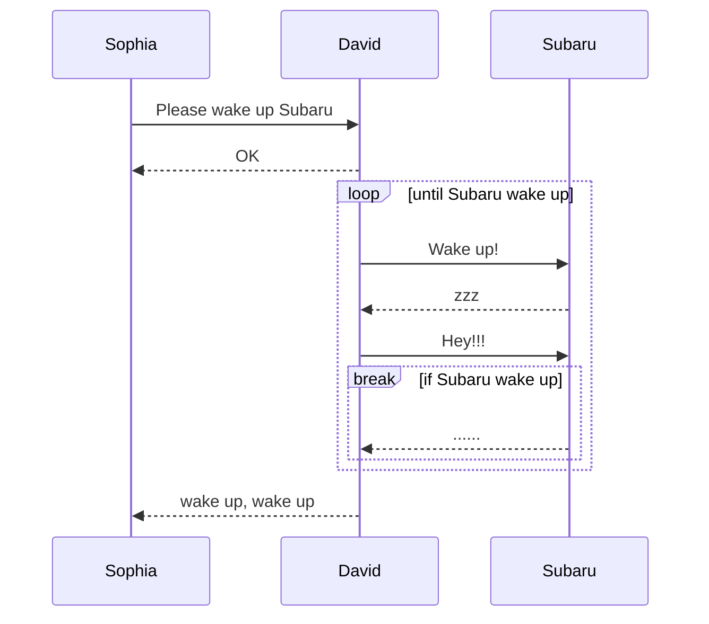
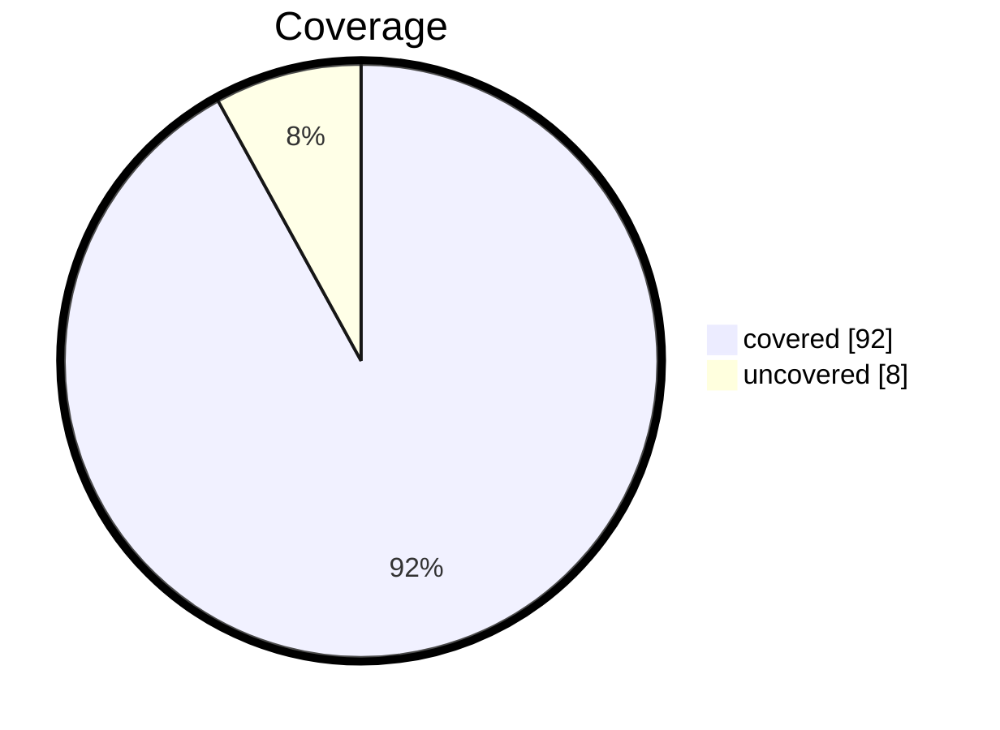

<!-- ALL-CONTRIBUTORS-BADGE:START - Do not remove or modify this section -->
[](#contributors-)
<!-- ALL-CONTRIBUTORS-BADGE:END -->
[](https://github.com/nao1215/markdown/actions/workflows/unit_test.yml)

[](https://github.com/nao1215/markdown/actions/workflows/gitleaks.yml)
[](https://github.com/nao1215/markdown/actions/workflows/trivy.yml)
[](https://github.com/nao1215/markdown/actions/workflows/govulncheck.yml)
[](https://github.com/nao1215/markdown/actions/workflows/gosec.yml)
[](https://github.com/nao1215/markdown/actions/workflows/reviewdog.yml)
[](https://pkg.go.dev/github.com/nao1215/markdown)
[](./LICENSE)
[](https://scorecard.dev/viewer/?uri=github.com/nao1215/markdown)
[](https://github.com/avelino/awesome-go)


# markdown

markdown is a Go package that builds GitHub Markdown with method chaining instead of a template engine like [html/template](https://pkg.go.dev/html/template). It writes headings, lists, checkbox lists, tables, code blocks, blockquotes, horizontal rules, text formatting, links, images, details, footnotes, math expressions and alerts, plus 24 kinds of mermaid diagram, status badges, and an index for a directory of markdown files.

The library stays small on purpose, so features that add a lot of complexity, such as nested lists, will not be added. Every exported function has a runnable example on [pkg.go.dev](https://pkg.go.dev/github.com/nao1215/markdown).

## Install

Linux, macOS and Windows, Go 1.26 or later.

```shell
go get github.com/nao1215/markdown
```

## Basic usage

```go
package main

import (
	"os"

	md "github.com/nao1215/markdown"
)

func main() {
	md.NewMarkdown(os.Stdout, md.WithBlockSpacing()).
		H1("This is H1").
		PlainText("This is plain text").
		H2f("This is %s with text format", "H2").
		PlainTextf("Text formatting, such as %s and %s, %s styles.",
			md.Bold("bold"), md.Italic("italic"), md.Code("code")).
		H2("Code Block").
		CodeBlocks(md.SyntaxHighlightGo,
			`package main
import "fmt"

func main() {
	fmt.Println("Hello, World!")
}`).
		H2("List").
		BulletList("Bullet Item 1", "Bullet Item 2", "Bullet Item 3").
		OrderedList("Ordered Item 1", "Ordered Item 2", "Ordered Item 3").
		H2("CheckBox").
		CheckBox([]md.CheckBoxSet{
			{Checked: false, Text: md.Code("sample code")},
			{Checked: true, Text: md.Link("Go", "https://golang.org")},
			{Checked: false, Text: md.Strikethrough("strikethrough")},
		}).
		H2("Blockquote").
		Blockquote("If you can dream it, you can do it.").
		H3("Horizontal Rule").
		HorizontalRule().
		H2("Table").
		Table(md.TableSet{
			Header: []string{"Name", "Age", "Country"},
			Rows: [][]string{
				{"David", "23", "USA"},
				{"John", "30", "UK"},
				{"Bob", "25", "Canada"},
			},
		}).
		H2("Image").
		PlainTextf(md.Image("sample_image", "./sample.png")).
		Build()
}
```

Output:
Output:
````
# This is H1

This is plain text

## This is H2 with text format

Text formatting, such as **bold** and *italic*, `code` styles.

## Code Block

```go
package main
import "fmt"

func main() {
	fmt.Println("Hello, World!")
}
```

## List

- Bullet Item 1
- Bullet Item 2
- Bullet Item 3

1. Ordered Item 1
2. Ordered Item 2
3. Ordered Item 3

## CheckBox

- [ ] `sample code`
- [x] [Go](https://golang.org)
- [ ] ~~strikethrough~~

## Blockquote

> If you can dream it, you can do it.

### Horizontal Rule

---

## Table

| Name | Age | Country |
|---------|---------|---------|
| David | 23 | USA |
| John | 30 | UK |
| Bob | 25 | Canada |

## Image


````

The rendered result is in [doc/generated_example.md](./doc/generated_example.md).

## Generate Markdown with go generate

Put the builder in a `main.go` with a `//go:generate` line, then run `go generate ./...`.

[Code example:](./doc/generate/main.go)
```go
package main

import (
	"os"

	md "github.com/nao1215/markdown"
)

//go:generate go run main.go

func main() {
	f, err := os.Create("generated.md")
	if err != nil {
		panic(err)
	}
	defer f.Close()

	md.NewMarkdown(f).
		H1("go generate example").
		PlainText("This markdown is generated by `go generate`").
		Build()
}
```

```shell
go generate ./...
```

[Output:](./doc/generate/generated.md)
````text
# go generate example
This markdown is generated by `go generate`
````

## Alerts and status badges

[Code example:](./doc/alert/main.go)
```go
	md.NewMarkdown(f).
		H1("Alert example").
		Note("This is note").LF().
		Tip("This is tip").LF().
		Important("This is important").LF().
		Warning("This is warning").LF().
		Caution("This is caution").LF().
		Build()
```

[Output:](./doc/alert/generated.md)
````text
# Alert example
> [!NOTE]  
> This is note
  
> [!TIP]  
> This is tip
  
> [!IMPORTANT]  
> This is important
  
> [!WARNING]  
> This is warning
  
> [!CAUTION]  
> This is caution
````

[Code example:](./doc/badge/main.go)
```go
	md.NewMarkdown(os.Stdout).
		H1("badge example").
		RedBadge("red_badge").
		YellowBadge("yellow_badge").
		GreenBadge("green_badge").
		BlueBadge("blue_badge").
		Build()
```

[Output:](./doc/badge/generated.md)
````text
# badge example


````

## Mermaid diagrams

Each diagram type has its own builder package. The builder returns the diagram as a string, which you put in a mermaid code block:

```go
package main

import (
	"io"
	"os"

	"github.com/nao1215/markdown"
	"github.com/nao1215/markdown/mermaid/sequence"
)

//go:generate go run main.go

func main() {
	diagram := sequence.NewDiagram(io.Discard).
		Participant("Sophia").
		Participant("David").
		Participant("Subaru").
		LF().
		SyncRequest("Sophia", "David", "Please wake up Subaru").
		SyncResponse("David", "Sophia", "OK").
		LF().
		LoopStart("until Subaru wake up").
		SyncRequest("David", "Subaru", "Wake up!").
		SyncResponse("Subaru", "David", "zzz").
		SyncRequest("David", "Subaru", "Hey!!!").
		BreakStart("if Subaru wake up").
		SyncResponse("Subaru", "David", "......").
		BreakEnd().
		LoopEnd().
		LF().
		SyncResponse("David", "Sophia", "wake up, wake up").
		String()

	markdown.NewMarkdown(os.Stdout, markdown.WithBlockSpacing()).
		H2("Sequence Diagram").
		CodeBlocks(markdown.SyntaxHighlightMermaid, diagram).
		Build()
}
```

Plain text output: [markdown is here](./doc/sequence/generated.md)
````
## Sequence Diagram


````

Mermaid output:


The other diagram types work the same way. Each has a generator under `doc/` and the document it writes:

| Diagram | Package | Code | Output |
|:--|:--|:--|:--|
| Sequence diagram | [`mermaid/sequence`](https://pkg.go.dev/github.com/nao1215/markdown/mermaid/sequence) | [main.go](./doc/sequence/main.go) | [generated.md](./doc/sequence/generated.md) |
| User journey | [`mermaid/userjourney`](https://pkg.go.dev/github.com/nao1215/markdown/mermaid/userjourney) | [main.go](./doc/userjourney/main.go) | [generated.md](./doc/userjourney/generated.md) |
| Git graph | [`mermaid/gitgraph`](https://pkg.go.dev/github.com/nao1215/markdown/mermaid/gitgraph) | [main.go](./doc/gitgraph/main.go) | [generated.md](./doc/gitgraph/generated.md) |
| Mindmap | [`mermaid/mindmap`](https://pkg.go.dev/github.com/nao1215/markdown/mermaid/mindmap) | [main.go](./doc/mindmap/main.go) | [generated.md](./doc/mindmap/generated.md) |
| Requirement diagram | [`mermaid/requirement`](https://pkg.go.dev/github.com/nao1215/markdown/mermaid/requirement) | [main.go](./doc/requirement/main.go) | [generated.md](./doc/requirement/generated.md) |
| XY chart | [`mermaid/xychart`](https://pkg.go.dev/github.com/nao1215/markdown/mermaid/xychart) | [main.go](./doc/xychart/main.go) | [generated.md](./doc/xychart/generated.md) |
| Packet | [`mermaid/packet`](https://pkg.go.dev/github.com/nao1215/markdown/mermaid/packet) | [main.go](./doc/packet/main.go) | [generated.md](./doc/packet/generated.md) |
| Block diagram | [`mermaid/block`](https://pkg.go.dev/github.com/nao1215/markdown/mermaid/block) | [main.go](./doc/block/main.go) | [generated.md](./doc/block/generated.md) |
| Kanban | [`mermaid/kanban`](https://pkg.go.dev/github.com/nao1215/markdown/mermaid/kanban) | [main.go](./doc/kanban/main.go) | [generated.md](./doc/kanban/generated.md) |
| Entity relationship diagram | [`mermaid/er`](https://pkg.go.dev/github.com/nao1215/markdown/mermaid/er) | [main.go](./doc/er/main.go) | [generated.md](./doc/er/generated.md) |
| Flowchart | [`mermaid/flowchart`](https://pkg.go.dev/github.com/nao1215/markdown/mermaid/flowchart) | [main.go](./doc/flowchart/main.go) | [generated.md](./doc/flowchart/generated.md) |
| Pie chart | [`mermaid/piechart`](https://pkg.go.dev/github.com/nao1215/markdown/mermaid/piechart) | [main.go](./doc/piechart/main.go) | [generated.md](./doc/piechart/generated.md) |
| Architecture (mermaid beta) | [`mermaid/arch`](https://pkg.go.dev/github.com/nao1215/markdown/mermaid/arch) | [main.go](./doc/architecture/main.go) | [generated.md](./doc/architecture/generated.md) |
| State diagram | [`mermaid/state`](https://pkg.go.dev/github.com/nao1215/markdown/mermaid/state) | [main.go](./doc/state/main.go) | [generated.md](./doc/state/generated.md) |
| Class diagram | [`mermaid/class`](https://pkg.go.dev/github.com/nao1215/markdown/mermaid/class) | [main.go](./doc/class/main.go) | [generated.md](./doc/class/generated.md) |
| Quadrant chart | [`mermaid/quadrant`](https://pkg.go.dev/github.com/nao1215/markdown/mermaid/quadrant) | [main.go](./doc/quadrant/main.go) | [generated.md](./doc/quadrant/generated.md) |
| Gantt chart | [`mermaid/gantt`](https://pkg.go.dev/github.com/nao1215/markdown/mermaid/gantt) | [main.go](./doc/gantt/main.go) | [generated.md](./doc/gantt/generated.md) |
| Timeline | [`mermaid/timeline`](https://pkg.go.dev/github.com/nao1215/markdown/mermaid/timeline) | [main.go](./doc/timeline/main.go) | [generated.md](./doc/timeline/generated.md) |
| Sankey | [`mermaid/sankey`](https://pkg.go.dev/github.com/nao1215/markdown/mermaid/sankey) | [main.go](./doc/sankey/main.go) | [generated.md](./doc/sankey/generated.md) |
| Radar | [`mermaid/radar`](https://pkg.go.dev/github.com/nao1215/markdown/mermaid/radar) | [main.go](./doc/radar/main.go) | [generated.md](./doc/radar/generated.md) |
| Treemap | [`mermaid/treemap`](https://pkg.go.dev/github.com/nao1215/markdown/mermaid/treemap) | [main.go](./doc/treemap/main.go) | [generated.md](./doc/treemap/generated.md) |
| C4 context | [`mermaid/c4`](https://pkg.go.dev/github.com/nao1215/markdown/mermaid/c4) | [main.go](./doc/c4/main.go) | [generated.md](./doc/c4/generated.md) |
| Venn | [`mermaid/venn`](https://pkg.go.dev/github.com/nao1215/markdown/mermaid/venn) | [main.go](./doc/venn/main.go) | [generated.md](./doc/venn/generated.md) |
| Wardley map | [`mermaid/wardley`](https://pkg.go.dev/github.com/nao1215/markdown/mermaid/wardley) | [main.go](./doc/wardley/main.go) | [generated.md](./doc/wardley/generated.md) |

## Write GitHub Actions job summaries

Inside a GitHub Actions step, the file named by `GITHUB_STEP_SUMMARY` is rendered on the run's summary page as GitHub Flavored Markdown, mermaid diagrams included, so a Go tool in CI can report with tables, alerts and charts:

```go
package main

import (
	"io"
	"os"

	"github.com/nao1215/markdown"
	"github.com/nao1215/markdown/mermaid/piechart"
)

func main() {
	// Inside a step, append to the summary the runner renders; outside one,
	// write a local file.
	path := os.Getenv("GITHUB_STEP_SUMMARY")
	flags := os.O_APPEND | os.O_CREATE | os.O_WRONLY
	if path == "" {
		path = "generated.md"
		flags = os.O_TRUNC | os.O_CREATE | os.O_WRONLY
	}
	f, err := os.OpenFile(path, flags, 0o600)
	if err != nil {
		panic(err)
	}
	defer func() {
		if err := f.Close(); err != nil {
			panic(err)
		}
	}()

	coverage := piechart.NewPieChart(
		io.Discard,
		piechart.WithTitle("Coverage"),
		piechart.WithShowData(true),
	).
		LabelAndIntValue("covered", 92).
		LabelAndIntValue("uncovered", 8).
		String()

	err = markdown.NewMarkdown(f, markdown.WithBlockSpacing()).
		H2("Test Results").
		Table(markdown.TableSet{
			Header: []string{"Package", "Passed", "Failed"},
			Rows: [][]string{
				{"api", "120", "0"},
				{"core", "89", "2"},
			},
		}).
		Warning("2 tests failed in core; see the failed step for logs.").
		CodeBlocks(markdown.SyntaxHighlightMermaid, coverage).
		Build()

	if err != nil {
		panic(err)
	}
}
```

Plain text output: [markdown is here](./doc/actions-summary/generated.md)
````text
## Test Results

| Package | Passed | Failed |
|---------|---------|---------|
| api | 120 | 0 |
| core | 89 | 2 |

> [!WARNING]  
> 2 tests failed in core; see the failed step for logs.


````

## Create an index for a directory of markdown files

`GenerateIndex` writes an index of every Markdown file under a directory. It was written for the documents [nao1215/spectest](https://github.com/nao1215/spectest) produces. Given this tree:

```shell
testdata
├── abc
│   ├── dummy.txt
│   ├── jkl
│   │   └── text.md
│   └── test.md
├── def
│   ├── test.md
│   └── test2.md
├── expected
│   └── index.md
├── ghi
└── test.md
```

this call:

```go
		if err := GenerateIndex(
			"testdata", // target directory that contains markdown files
			WithTitle("Test Title"), // title of index markdown
			WithDescription([]string{"Test Description", "Next Description"}), // description of index markdown
		); err != nil {
			panic(err)
		}
```

writes `testdata/index.md` (change the destination with `WithWriter()`). Each link is named after the first H1 or H2 in the target file, or the file name when it has neither.

[Output:](./doc/index.md)
```markdown
## Test Title
Test Description
  
Next Description
  
### testdata
- [test.md](test.md)
  
### abc
- [h2 is here](abc/test.md)
  
### jkl
- [text.md](abc/jkl/text.md)
  
### def
- [h2 is first, not h1](def/test.md)
- [h1 is here](def/test2.md)
  
### expected
- [Test Title](expected/index.md)
```

## Verifying releases

Since v1.1.3, each GitHub Release has a source archive (`markdown-<tag>.tar.gz`), `checksums.txt`, a keyless cosign signature of it (`checksums.txt.sigstore.json`) and the build provenance of the archive (`markdown-<tag>.intoto.jsonl`). Download them from the release page (replace `<tag>` with the release tag), then verify:

```bash
gh attestation verify markdown-<tag>.tar.gz --repo nao1215/markdown \
  --bundle markdown-<tag>.intoto.jsonl

cosign verify-blob --bundle checksums.txt.sigstore.json \
  --certificate-identity-regexp '^https://github\.com/nao1215/markdown/\.github/workflows/release\.yml@refs/tags/v' \
  --certificate-oidc-issuer https://token.actions.githubusercontent.com \
  checksums.txt

sha256sum --check checksums.txt
```

## Testing

| Technique | Bug class caught here |
|---|---|
| [Unit tests and godoc examples](markdown_test.go) | Wrong bytes from a builder method, on Linux, macOS and Windows |
| [Golden files](testdata/golden) | Unintended changes to a whole generated document |
| [Parsing the output back](contract_test.go) | Output that reads fine but renders as something else: a table that loses a column, a list that swallows a paragraph |
| [Property-based tests](contract_test.go) | Escaped tables, lists, headings and code blocks that do not keep their shape for some input |
| [Metamorphic tests](contract_test.go) | Blocks that merge or change kind depending on `WithBlockSpacing` |
| [Fuzzing](.github/workflows/fuzz.yml) | Escaping, anchors and fences that break on arbitrary text |
| [Mutation testing](.github/workflows/mutation.yml) | Tests that run changed code without checking its result |
| [Mermaid render check](scripts/mermaid-check) | Diagrams that the real mermaid renderer rejects or draws differently |

The commands and CI jobs for each are in [doc/testing.md](doc/testing.md).

## License
[MIT License](./LICENSE)

## Contribution
See [CONTRIBUTING.md](./CONTRIBUTING.md). Bug reports, feature requests and GitHub Stars all help.

### Contributors ✨

Thanks goes to these wonderful people ([emoji key](https://allcontributors.org/docs/en/emoji-key)):

<!-- ALL-CONTRIBUTORS-LIST:START - Do not remove or modify this section -->
<!-- prettier-ignore-start -->
<!-- markdownlint-disable -->
<table>
  <tbody>
    <tr>
      <td align="center" valign="top" width="14.28%"><a href="https://debimate.jp/"><br /><sub><b>CHIKAMATSU Naohiro</b></sub></a><br /><a href="https://github.com/nao1215/markdown/commits?author=nao1215" title="Code">💻</a></td>
      <td align="center" valign="top" width="14.28%"><a href="https://github.com/varmakarthik12"><br /><sub><b>Karthik Sundari</b></sub></a><br /><a href="https://github.com/nao1215/markdown/commits?author=varmakarthik12" title="Code">💻</a> <a href="#ideas-varmakarthik12" title="Ideas, Planning, & Feedback">🤔</a></td>
      <td align="center" valign="top" width="14.28%"><a href="https://github.com/Avihuc"><br /><sub><b>Avihuc</b></sub></a><br /><a href="https://github.com/nao1215/markdown/commits?author=Avihuc" title="Code">💻</a></td>
      <td align="center" valign="top" width="14.28%"><a href="https://www.claranceliberi.me/"><br /><sub><b>Clarance Liberiste Ntwari</b></sub></a><br /><a href="https://github.com/nao1215/markdown/commits?author=claranceliberi" title="Code">💻</a></td>
      <td align="center" valign="top" width="14.28%"><a href="https://github.com/amitaifrey"><br /><sub><b>Amitai Frey</b></sub></a><br /><a href="https://github.com/nao1215/markdown/commits?author=amitaifrey" title="Code">💻</a></td>
      <td align="center" valign="top" width="14.28%"><a href="https://github.com/wI2L"><br /><sub><b>William Poussier</b></sub></a><br /><a href="#ideas-wI2L" title="Ideas, Planning, & Feedback">🤔</a></td>
      <td align="center" valign="top" width="14.28%"><a href="https://hibare.in/"><br /><sub><b>Shubham Hibare</b></sub></a><br /><a href="https://github.com/nao1215/markdown/issues?q=author%3Ahibare" title="Bug reports">🐛</a></td>
    </tr>
    <tr>
      <td align="center" valign="top" width="14.28%"><a href="https://barrymorrison.com/"><br /><sub><b>Barry Morrison</b></sub></a><br /><a href="#ideas-esacteksab" title="Ideas, Planning, & Feedback">🤔</a></td>
      <td align="center" valign="top" width="14.28%"><a href="https://github.com/chaunsin"><br /><sub><b>chaunsin</b></sub></a><br /><a href="#ideas-chaunsin" title="Ideas, Planning, & Feedback">🤔</a></td>
      <td align="center" valign="top" width="14.28%"><a href="https://evilbitlabs.io"><br /><sub><b>EvilBit Labs LLC</b></sub></a><br /><a href="#financial-EvilBit-Labs" title="Financial">💵</a></td>
      <td align="center" valign="top" width="14.28%"><a href="https://unclesp1d3r.github.io"><br /><sub><b>UncleSp1d3r</b></sub></a><br /><a href="#financial-unclesp1d3r" title="Financial">💵</a></td>
    </tr>
  </tbody>
  <tfoot>
    <tr>
      <td align="center" size="13px" colspan="7">
        
          <a href="https://all-contributors.js.org/docs/en/bot/usage">Add your contributions</a>
        </img>
      </td>
    </tr>
  </tfoot>
</table>

<!-- markdownlint-restore -->
<!-- prettier-ignore-end -->

<!-- ALL-CONTRIBUTORS-LIST:END -->

This project follows the [all-contributors](https://github.com/all-contributors/all-contributors) specification. Contributions of any kind are welcome, and that includes bug reports and feature requests: several of the features above exist because someone opened an issue asking for them.
